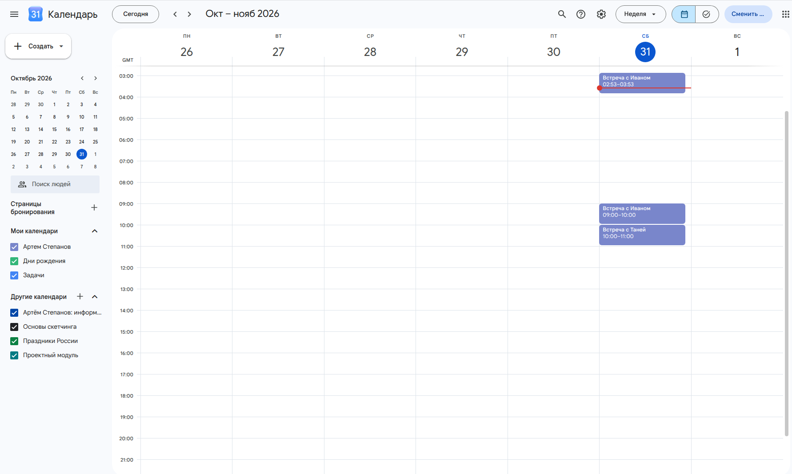
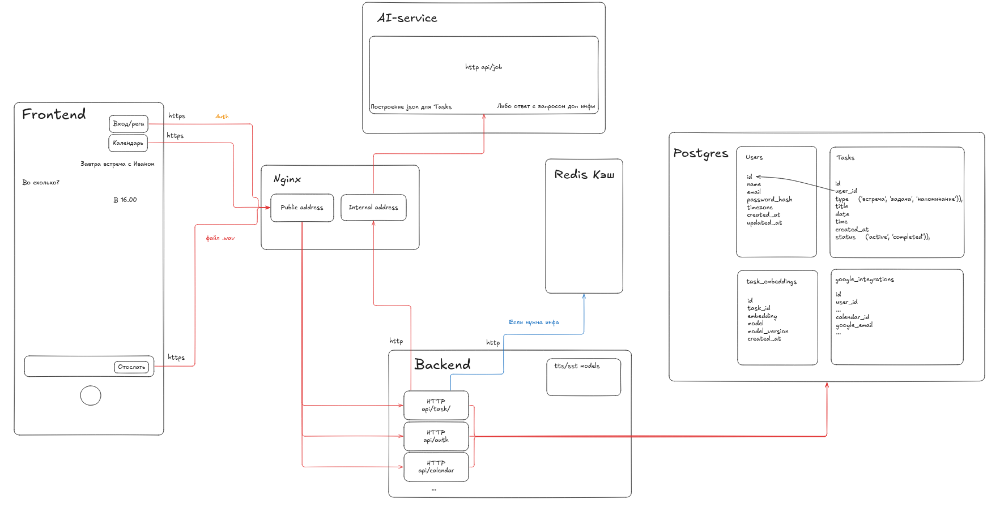

# GorkyCode

Голосовой помощник для задач, напоминаний и встреч. Backend на Go принимает
текст или WAV, запрашивает действие у AI-сервиса и работает с PostgreSQL.
Контекст уточнений и сессии хранятся в Redis.
После обращения к БД backend передаёт результат AI-сервису через
`POST /api/respond` для формулировки ответа. При сбое генерации используется
резервное сообщение, а выполненная операция сохраняется.

## Быстрый запуск

1. При первом запуске создайте файлы настроек и укажите `CLOUDRU_API_KEY` в `ai-service/.env`:

   ```bash
   cp ai-service/.env.example ai-service/.env
   cp backend/.env.example backend/.env
   ```

2. Поднимите базу и примените миграции (нужен установленный `goose`):

   ```bash
   docker-compose up -d postgres redis
   make -C backend migrate
   ```

3. Запустите сервисы из корня проекта:

   ```bash
   docker-compose up -d --build
   ```

Откройте `http://localhost:8088` и проверьте `http://localhost:8088/health`.
Первая сборка загружает модели и может занять время. Для изменения портов
скопируйте корневой `.env.example` в `.env`; при изменении порта PostgreSQL обновите
`DATABASE_URL` в `backend/.env`. Остановка: `docker-compose down`.

## Что реализовано

### Работа с естественным языком

#### Намерения и действия

AI-сервис разбирает свободный текст, в том числе относительные даты, и определяет действие: создать, показать, найти, изменить или удалить запись. Запрос без действия обрабатывается как обычный разговор.

#### Уточнения и контекст диалога

Если данных не хватает, ассистент задаёт вопрос. Ответ передаётся с тем же `task_id`; если ID нет или контекст истёк, начинается новый диалог. Короткую реплику без контекста сервис просит повторить полностью.

#### Поиск и фильтрация записей

AI-сервис извлекает из запроса период, тип, статус и другие доступные фильтры. Backend ищет по названию и смысловой близости; перед изменением или удалением показывает кандидатов с номерами для выбора.

### Хранение данных

Записи хранятся в PostgreSQL. Для названия записи AI-сервис строит вектор E5, который сохраняется в pgvector. При поиске backend сравнивает вектор запроса с сохранёнными и объединяет близкие по смыслу результаты с буквальными совпадениями названий. Если векторный поиск недоступен, буквальный продолжает работать.

#### Модель записей и статусы

У записи есть тип (`task`, `reminder`, `meeting`), название, дата, необязательное для задачи время, дата создания и статус. У задачи статусы `active`, `in_progress`, `completed`; у встречи и напоминания — `active`, `completed`.

#### Контекст и сессии

Redis хранит контекст диалога и сессии авторизации. Контекст живёт 24 часа и продлевается при продолжении разговора; срок сессии настраивается, по умолчанию тоже 24 часа.

### Голосовое взаимодействие

#### Обработка голосового запроса

Backend принимает WAV, распознаёт речь локальной моделью Sherpa ONNX и обрабатывает полученный текст как обычный запрос. Ответ пока возвращается текстом.

### Интеграция с Google Calendar

Пользователь подключает календарь через Google OAuth. Для этого на сервисе нужно авторизовываться с google почтой. Новые встречи отправляются в основной календарь; перед созданием проверяется занятость в базе. При конфликте сервис просит выбрать другое время. Изменение и удаление встреч с Google пока не синхронизируются.

Интеграция с календарём: 

### Ответы пользователю

`POST /api/task` возвращает статус, `task_id`, сообщение и данные результата. После действия backend передаёт фактический результат в AI-сервис для формулировки ответа; при сбое генерации возвращает резервный текст.

#### Напоминания

Напоминания по вебсокету приходят в чат. Также, если казать при регистрации существующую почту, то напоминания придут рассылкой на почту

## Архитектура

### Компоненты и их ответственность

Nginx раздаёт frontend и направляет запросы. Backend на Go отвечает за API, авторизацию, голос и операции с данными; AI-сервис на FastAPI разбирает запросы, строит эмбеддинги и формулирует ответы. PostgreSQL хранит записи, Redis — временное состояние.

Схема архитектуры отображена здесь: 

### Путь запроса

Клиент отправляет текст или WAV в backend. После распознавания речи backend получает от AI-сервиса структурированное действие, проверяет его и работает с БД. Затем передаёт результат AI-сервису для формулировки ответа пользователю.

## Принятые решения

### Разделение действий и формулировки ответа

Модель предлагает действие, но не обращается к базе. Backend проверяет входные данные, владельца записи и результат операции; сообщение строится по уже полученным данным.

### Надёжность диалога и операций

Потерянный или устаревший `task_id` не ломает диалог: сервис начинает новый. Если ответ модели не соответствует схеме, ассистент просит уточнить запрос без изменения записей. Недоступность БД, Redis или AI-сервиса возвращается как ошибка сервиса.

### Поиск и хранение контекста

PostgreSQL с pgvector объединяет хранение записей и поиск по смыслу. Redis хранит краткоживущий контекст уточнений, выбор кандидатов и сессии.

### Обоснование архитектуры

Nginx служит единой точкой входа: на открытом адресе раздаёт frontend и направляет API-запросы в backend, на закрытом — направляет запросы backend к AI-сервису. При росте нагрузки можно запустить больше экземпляров обоих сервисов: Nginx будет распределять клиентские запросы между backend-репликами, а внутренние — между AI-репликами. Сейчас запущено по одному экземпляру каждого сервиса.


## Короткий список по ТЗ

- [x] Свободные текстовые запросы и голосовой ввод с распознаванием речи.
- [x] Создание задач, напоминаний и встреч; сохранение между запросами.
- [x] Список записей за период и поиск старых записей, включая семантический.
- [x] Текстовый ответ и уточнение неоднозначных запросов с контекстом диалога.
- [x] Изменение, удаление и отметка задачи выполненной.
- [x] Проверка конфликтов встреч и несколько пользователей.
- [ ] Голосовой ответ (Text-to-Speech).
