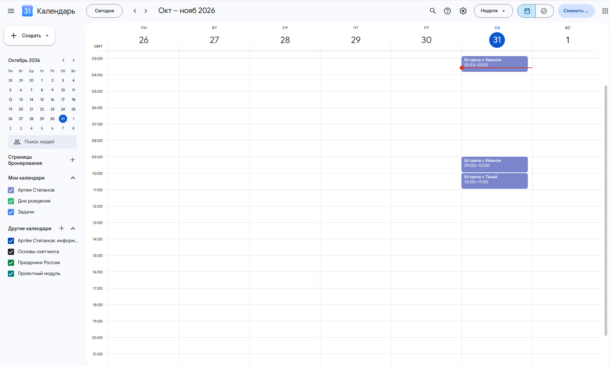
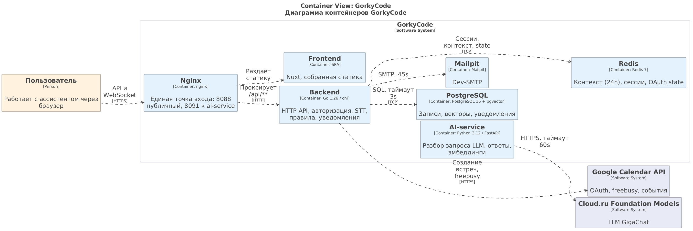

# 🤖 GorkyCode

**GorkyCode** — интеллектуальный голосовой помощник для управления задачами, напоминаниями, встречами и повседневного общения.

Ассистент понимает запросы на естественном языке, позволяет создавать, изменять и удалять записи, а также находить ранее созданные события и задачи. Встречи и напоминания можно синхронизировать с **Google Calendar**.

Чтобы пользователь не пропустил важные события, GorkyCode отправляет уведомления **в чат приложения** и, при настроенном SMTP, **на электронную почту**. Ответ ассистента пока только текстовый.

---

## 🚀 Быстрый запуск

Нужны Docker Compose v2.24+, `make`, установленный `goose` и ключ Cloud.ru Foundation Models. Миграции не применяются автоматически. Команды выполняются из корня проекта.

1. Создайте файлы настроек и укажите `CLOUDRU_API_KEY` в `ai-service/.env`:

   ```bash
   cp .env.example .env
   cp ai-service/.env.example ai-service/.env
   cp backend/.env.example backend/.env
   ```

2. Поднимите базу и примените миграции (нужен установленный `goose`):

   ```bash
   docker compose up -d postgres redis
   make -C backend migrate
   ```

3. Запустите сервисы из корня проекта:

   ```bash
   docker compose up -d --build
   ```

Откройте <http://localhost:8088>. Проверка: `/health` показывает, что backend запущен, `/ready` — что он готов работать с БД; `docker compose ps` показывает состояние AI-сервиса (`healthy`). Первая сборка загружает модели и может занять время. Остановка без удаления данных и моделей: `docker compose down`.

Корневой `.env` задаёт порты, PostgreSQL и Google OAuth; `backend/.env` — настройки backend, миграций и почты; `ai-service/.env` — ключ и модель Cloud.ru. Ключи Google для Docker указывайте в **корневом** `.env`: значения из Compose перекрывают `backend/.env`. При смене реквизитов PostgreSQL обновите также `DATABASE_URL` в `backend/.env` для миграций. Файлы `.env` исключены из Git.

## ✨ Что реализовано

Основной сценарий — веб-интерфейс на <http://localhost:8088>: регистрация, чат, голосовой ввод и подключение календаря. Например: «Создай задачу купить билеты до конца недели», «Что у меня завтра?», «Найди дела про договор». Для API доступны [`contracts/`](contracts/) и [Postman-коллекции](docs/postman/); `POST /api/task` принимает текст или WAV с авторизацией Bearer, а `GET /api/v1/tasks` возвращает список без AI-диалога.

### 🧠 Работа с естественным языком

#### 🎯 Намерения и действия

AI-сервис разбирает свободный текст, в том числе относительные даты («завтра», «через час», «до конца недели»), и определяет действие: создать, показать, найти, изменить или удалить запись. Запрос без действия обрабатывается как обычный разговор.

#### 💬 Уточнения и контекст диалога

Если данных не хватает, ассистент задаёт вопрос. Ответ передаётся с тем же `task_id`; если ID нет или контекст истёк, начинается новый диалог. Короткую реплику без контекста сервис просит повторить полностью. Контекст хранится 24 часа.

#### 🔎 Поиск и фильтрация записей

AI-сервис извлекает из запроса период, тип, статус и другие доступные фильтры. Backend ищет по названию и смысловой близости. Перед изменением или удалением он показывает кандидатов с номерами: действие выполняется только после явного выбора, в том числе нескольких номеров через запятую.

### 🗄️ Хранение данных

Записи хранятся в PostgreSQL. Для названия записи AI-сервис строит вектор `intfloat/multilingual-e5-small` (384 измерения), который сохраняется в pgvector. При поиске backend сравнивает вектор запроса с сохранёнными и объединяет близкие по смыслу результаты с буквальными совпадениями названий. Если векторный поиск недоступен, буквальный продолжает работать.

#### 📋 Модель записей и статусы

У записи есть тип (`task`, `reminder`, `meeting`), название, дата, необязательное для задачи время, дата создания и статус. У задачи статусы `active`, `in_progress`, `completed`; у встречи и напоминания — `active`, `completed`.

#### 🔑 Контекст и сессии

Redis хранит контекст диалога и сессии авторизации. Контекст живёт 24 часа и продлевается при продолжении разговора; срок сессии настраивается, по умолчанию тоже 24 часа.

### 🎙️ Голосовое взаимодействие

#### 🎧 Обработка голосового запроса

Backend принимает WAV до 20 МиБ, распознаёт речь локально через sherpa-onnx и обрабатывает текст как обычный запрос. Поддерживаются Zipformer RU (`sherpa-onnx-zipformer-ru-2024-09-18`) и GigaAM v3 NeMo CTC; в текущем Docker Compose задана GigaAM v3. Ответ пока возвращается текстом.

### 📅 Интеграция с Google Calendar

Пользователь подключает календарь через Google OAuth. Новые встречи и напоминания отправляются в основной календарь; их изменение и удаление также передаются в Google, но сбой синхронизации не отменяет уже выполненную операцию в приложении. Задачи в Google Calendar не отправляются. Перед созданием встречи проверяется занятость в базе; дополнительная проверка занятости Google включается настройкой `GOOGLE_CHECK_BUSY` (по умолчанию выключена). При конфликте сервис просит выбрать другое время.

Интеграция с календарём:



### 💬 Ответы пользователю

`POST /api/task` возвращает статус, `task_id`, сообщение и данные результата. После действия backend передаёт фактический результат в AI-сервис для формулировки ответа; при сбое генерации возвращает резервный текст.

#### 🔔 Напоминания

Для записей планируются уведомления в момент события и заранее — по умолчанию за 72 часа, 24 часа, 3 часа и 10 минут, если до события достаточно времени. В чат они приходят по WebSocket; неподтверждённые сообщения досылаются после переподключения. Письма отправляются на адрес аккаунта только при настроенном SMTP.

---

## 🏗️ Архитектура

### 🧩 Компоненты и их ответственность

Nginx раздаёт собранный Nuxt 4 frontend и направляет запросы. Исходники фронта находятся в [отдельном репозитории](https://github.com/yegorweb/GorkyCodeFrontend), здесь лежит статика в `frontend/public/`. Backend на Go 1.26 отвечает за API, авторизацию, голос, планировщик уведомлений и операции с данными. AI-сервис на Python 3.12/FastAPI использует Cloud.ru Foundation Models (GigaChat) для разбора запросов и ответов, а локальную модель E5 — для эмбеддингов. PostgreSQL 16 с pgvector хранит записи и векторы, Redis 7 — контекст диалога, сессии и OAuth-state. Контракты OpenAPI лежат в [`contracts/`](contracts/).

Диаграммы генерируются из Structurizr DSL. Контейнерный уровень:



Остальные виды: [контекст](docs/media/architecture-context.png), [поток запроса](docs/media/task-flow.png), [уведомления](docs/media/notifications.png), [схема данных](docs/media/database-schema.png). Есть и [интерактивная версия](docs/diagrams/site/index.html).

### 🔄 Путь запроса

Клиент отправляет текст или WAV в backend. После распознавания речи backend получает от AI-сервиса структурированное действие, проверяет его и работает с БД. Затем передаёт результат AI-сервису для формулировки ответа пользователю.

---

## 💡 Принятые решения

### 🛡️ Разделение действий и формулировки ответа

Модель предлагает действие, но не обращается к базе. Backend проверяет входные данные, владельца записи и результат операции; сообщение строится по уже полученным данным.

### 🔒 Надёжность диалога и операций

Потерянный или устаревший `task_id` не ломает диалог: сервис начинает новый. Если ответ модели не соответствует схеме, ассистент просит уточнить запрос без изменения записей. Недоступность БД, Redis или AI-сервиса возвращается как ошибка сервиса.

### 🔍 Поиск и хранение контекста

PostgreSQL с pgvector объединяет хранение записей и поиск по смыслу. Redis хранит краткоживущий контекст уточнений, выбор кандидатов и сессии.

### 📈 Обоснование архитектуры

Nginx служит единой точкой входа: на открытом адресе раздаёт frontend и направляет API-запросы в backend, на закрытом — направляет запросы backend к AI-сервису. При росте нагрузки можно запустить больше экземпляров обоих сервисов: Nginx будет распределять клиентские запросы между backend-репликами, а внутренние — между AI-репликами. Сейчас запущено по одному экземпляру каждого сервиса.

---

## ✅ Короткий список по ТЗ

- [x] Свободные текстовые запросы и голосовой ввод с распознаванием речи.
- [x] Создание задач, напоминаний и встреч; сохранение между запросами.
- [x] Список записей за период и поиск старых записей, включая семантический.
- [x] Текстовый ответ и уточнение неоднозначных запросов с контекстом диалога.
- [x] Изменение, удаление и отметка задачи выполненной.
- [x] Проверка конфликтов встреч и несколько пользователей.
- [x] Google OAuth и синхронизация встреч и напоминаний с Google Calendar.
- [x] Уведомления в чате по WebSocket и письма при настроенном SMTP.
- [ ] Повторяющиеся события и обратный импорт изменений из Google Calendar.

