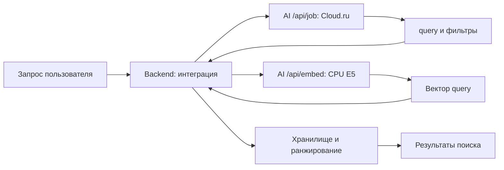

# Семантический поиск: граница AI и интеграция

Актуализировано 24 октября 2026. Документ описывает интеграцию `ai-service`
с backend и PostgreSQL и границы проверки этой цепочки.

## Реализовано в AI-service

1. `POST /api/job` обращается к Cloud.ru и возвращает действие `search_events`
   с темой `query` и необязательными фильтрами.
2. `POST /api/embed` независимо преобразует переданный текст в вектор E5.
3. Запросы и ответы проверяются по строгим схемам; код ограничивает deadline,
   размер embedding-тела и число одновременно занятых CPU workers.

`/api/job` не вызывает `/api/embed` автоматически. AI не хранит задачи,
не выполняет SQL, не поддерживает векторный индекс и не ранжирует записи.
Cloud.ru и локальная E5 выполняют разные операции.

## Поток интеграции



При создании записи backend запрашивает document-вектор названия и сохраняет
его в `task_embeddings` с `model` и `model_version`. Поиск использует
pgvector и только векторы той же версии модели.

При поиске потребитель выполняет следующие действия:

1. Отправляет текст и текущий context в `/api/job`.
2. При `needs_clarification` возвращает вопрос и сохраняет фактический context;
   поиск запускается после получения готового действия.
3. При `ready/search_events` передаёт извлечённый `query` в `/api/embed` с `purpose=query`.
4. Проверяет совместимость model/model_version с сохранёнными document-векторами.
5. Выполняет поиск с фильтрами доступа, дат и типов, объединяет результаты
   семантической и буквальной ветвей, удаляет дубликаты.

Для нормированных векторов скалярное произведение соответствует cosine similarity.
Backend ограничивает векторную выдачу 20 записями и применяет предварительный
порог cosine distance 0.6; его качество на пользовательских данных ещё не
откалибровано. Буквальные совпадения сохраняются независимо от этого порога.
Фильтры пользователя, дат и типов применяются к обеим ветвям.

## Действие поиска

Пример поля `action` готового ответа `/api/job`:

```json
{
  "query": "с Иваном",
  "record_types": ["meeting"],
  "date_from": "2026-10-26",
  "date_to_exclusive": "2026-11-02"
}
```

`query` — исходная смысловая тема без служебной просьбы. Она не заменяется
выдуманным названием записи. Фильтры необязательны; отсутствие поля означает
отсутствие соответствующего ограничения. Даты задают полуоткрытый интервал:
нижняя граница включается, верхняя исключается. Проверка порядка границ
делегирована backend каноническим контрактом.

`record_types` содержит уникальные `task`, `meeting`, `reminder`. Фильтра по
завершённости в действии нет. Нельзя незаметно превращать такую просьбу в
ограничение поиска или прятать её в query: prompt предусматривает уточнение.
Запрос списка без темы обрабатывается отдельным `list_events`, а не векторизацией.

## Векторизация

```json
{"purpose":"document","text":"Подготовить презентацию для команды"}
```

```json
{"purpose":"query","text":"задачи про слайды"}
```

Одна CPU-модель `intfloat/multilingual-e5-small`, 384 координаты, префиксы
`passage: ` и `query: ` добавляются внутри AI. Ответ — только `embedding`,
`model`, `model_version`. Правила версии, runtime и HTTP:
[embedding-encoder.md](../embedding-encoder.md).

При ошибке encoder или несовместимой версии нельзя выдавать технический отказ
за успешный пустой поиск. `/health` подтверждает жизнь процесса, а не готовность
Cloud.ru или E5. Retry создания записи должен учитывать неидемпотентность
операции потребителя; сам AI записи не создаёт.

## Проверенное состояние и пробелы

- 24 октября backend и AI собраны в Docker. Проверен настоящий `/api/embed` E5:
  document/query векторы содержат 384 конечных значений и одинаковую версию модели.
- Сквозной локальный HTTP-тест с PostgreSQL/pgvector, Redis, backend и настоящим
  encoder прошёл: создание, семантический поиск, список и уточнение перед
  удалением. `/api/job` в этом тесте заменялся
  локальным имитатором, так как ключ Cloud.ru не задан.
- Статические unit-тесты AI прошли (77 тестов и 59 subtests). Извлечение intent
  настоящей LLM по пользовательским формулировкам в этом прогоне не проверялось.
- [Корпус 60 документов/40 запросов](../../tests/fixtures/semantic-search/dataset.json)
  сохранён, но не используется текущим runner. Порог 0.6 предварительный;
  полноценной оценки точности ранжирования ещё нет.

Запуск: [cloudru-live-testing.md](../cloudru-live-testing.md).
Набор: [service-live-testing.md](../service-live-testing.md).
Результаты и карта файлов находятся в том же гайде тестирования.
Контрактные правила: [README сервиса](../../README.md).
