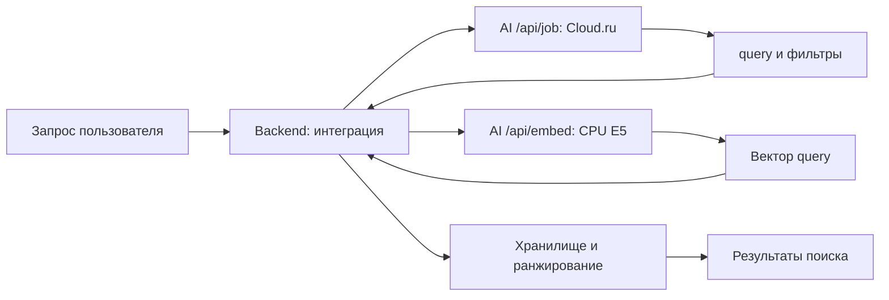

# Семантический поиск: граница AI и интеграция

Актуализировано 23 октября 2026. Документ описывает код `ai-service` и обязанности
потребителя его API. Текущее состояние backend/SQL здесь не проверялось;
перечень интеграционных шагов не является отчётом об их выполнении.

## Реализовано в AI-service

1. `POST /api/job` обращается к Cloud.ru и возвращает действие `search_events`
   с темой `query` и необязательными фильтрами.
2. `POST /api/embed` независимо преобразует переданный текст в вектор E5.
3. Запросы и ответы проверяются по строгим схемам; код ограничивает deadline,
   размер embedding-тела и число одновременно занятых CPU workers.

`/api/job` не вызывает `/api/embed` автоматически. AI не хранит задачи,
не выполняет SQL, не поддерживает векторный индекс и не ранжирует записи.
Cloud.ru и локальная E5 выполняют разные операции.

## Ожидаемый поток интеграции



До поиска backend должен получить document-вектор названия каждой записи
и сохранить его вместе с `model` и `model_version`. Создание, изменение названия
и пересчёт старых записей требуют обновления этих данных. Конкретная схема
хранения и индекс относятся к backend-интеграции.

При поиске потребитель выполняет следующие действия:

1. Отправляет текст и текущий context в `/api/job`.
2. При `needs_clarification` возвращает вопрос и сохраняет фактический context;
   поиск запускается после получения готового действия.
3. При `ready/search_events` передаёт извлечённый `query` в `/api/embed` с `purpose=query`.
4. Проверяет совместимость model/model_version с сохранёнными document-векторами.
5. Выполняет поиск с фильтрами доступа, дат и типов, объединяет результаты
   семантической и буквальной ветвей, удаляет дубликаты.

Для нормированных векторов скалярное произведение соответствует cosine similarity.
Способ индексации, лимит выдачи и порог релевантности здесь не реализованы и
не откалиброваны. Буквальные совпадения имён/кодов следует сохранять независимо
от семантического порога; фильтры должны одинаково применяться к обеим ветвям.

## Действие поиска

Пример поля `action` готового ответа `/api/job`:

```json
{
  "query": "с Иваном",
  "record_types": ["meeting"],
  "date_from": "2026-10-26",
  "date_to_exclusive": "2026-11-02"
}
```

`query` — исходная смысловая тема без служебной просьбы. Она не заменяется
выдуманным названием записи. Фильтры необязательны; отсутствие поля означает
отсутствие соответствующего ограничения. Даты задают полуоткрытый интервал:
нижняя граница включается, верхняя исключается. Проверка порядка границ
делегирована backend каноническим контрактом.

`record_types` содержит уникальные `task`, `meeting`, `reminder`. Фильтра по
завершённости в действии нет. Нельзя незаметно превращать такую просьбу в
ограничение поиска или прятать её в query: prompt предусматривает уточнение.
Запрос списка без темы обрабатывается отдельным `list_events`, а не векторизацией.

## Векторизация

```json
{"purpose":"document","text":"Подготовить презентацию для команды"}
```

```json
{"purpose":"query","text":"задачи про слайды"}
```

Одна CPU-модель `intfloat/multilingual-e5-small`, 384 координаты, префиксы
`passage: ` и `query: ` добавляются внутри AI. Ответ — только `embedding`,
`model`, `model_version`. Правила версии, runtime и HTTP:
[embedding-encoder.md](../embedding-encoder.md).

При ошибке encoder или несовместимой версии нельзя выдавать технический отказ
за успешный пустой поиск. `/health` подтверждает жизнь процесса, а не готовность
Cloud.ru или E5. Retry создания записи должен учитывать неидемпотентность
операции потребителя; сам AI записи не создаёт.

## Проверенное состояние и пробелы

- После очистки 73 HTTP/E5-проверки на хосте прошли. Они не оценивают ранжирование.
- В прежнем хостовом прогоне 70 LLM-тестов 49 провалились. Наличие готового endpoint
  не означает надёжного извлечения темы/фильтров для каждого сценария.
- [Корпус 60 документов/40 запросов](../../tests/fixtures/semantic-search/dataset.json)
  сохранён, но не используется текущим runner. Действующего evaluator ранжирования нет.
- Предварительные старые пороги и отчёты удалены; production-порог не установлен.
- PostgreSQL/pgvector E2E и фактическая пользовательская выдача в AI-тесты не входят.

Запуск: [cloudru-live-testing.md](../cloudru-live-testing.md).
Набор: [service-live-testing.md](../service-live-testing.md).
Результаты и карта файлов находятся в том же гайде тестирования.
Контрактные правила: [README сервиса](../../README.md).
